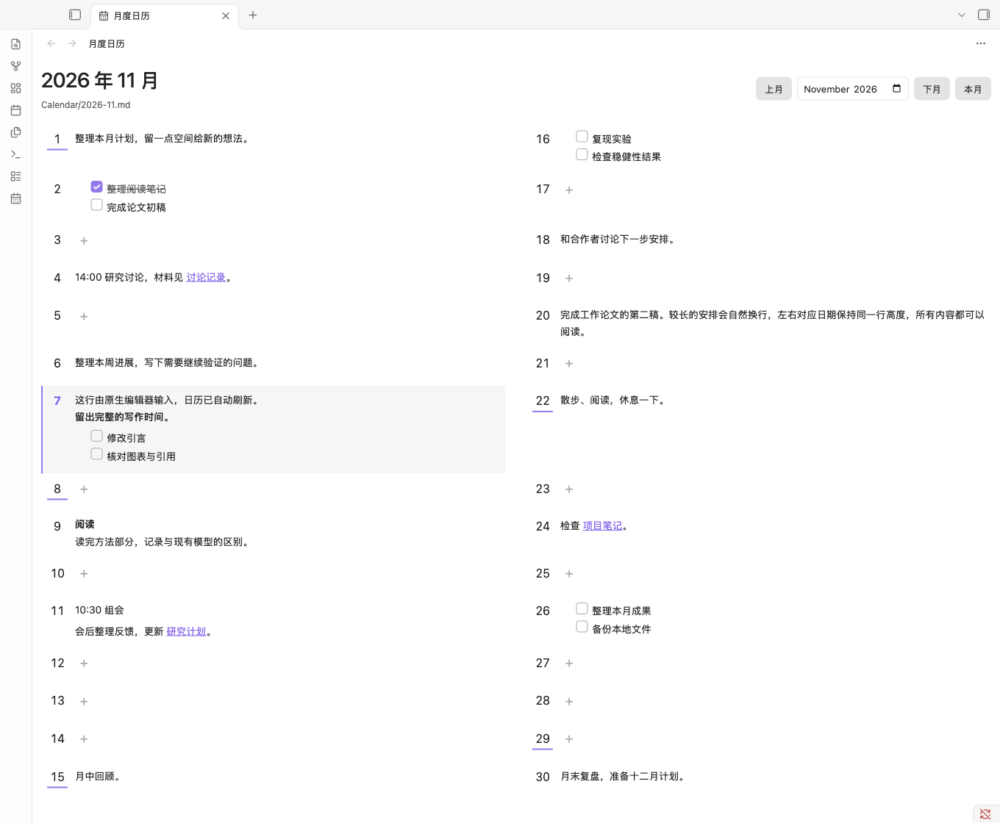

# Monthly Markdown Calendar

A lightweight, offline monthly calendar for Obsidian. Each month is a single local Markdown file. The desktop view shows days 1–15 on the left and the rest on the right; phone-sized panels show one chronological column. Click a date to edit its content in the native Markdown editor.

## Installation

Download `main.js`, `manifest.json`, and `styles.css` from the [latest release](https://github.com/lwg342/obsidian-monthly-view/releases/latest). Create `.obsidian/plugins/monthly-markdown-calendar/` inside your vault and place the three files directly in that folder. Reload Obsidian, enable **Monthly Markdown Calendar** under Settings → Community plugins, and run its **打开月度日历** (Open monthly calendar) command. The ribbon calendar icon opens the same view.

The [community listing](https://community.obsidian.md/plugins/monthly-markdown-calendar) is undergoing automated review. Availability in the in-app directory depends on that review.

## Usage

- By default, monthly notes live at `Calendar/YYYY-MM.md`. Change the folder in the plugin settings if needed.
- Start each day with a level-two date heading such as `## 2026-11-07`. Add paragraphs, lists, links, and tasks below it. See the [example month](examples/Calendar/2026-11.md).
- Click a date or its `+` button to open the native editor at that date. Missing files and sections offer an explicit creation dialog; existing content is never overwritten.
- Use the previous month, next month, month picker, and current month controls to navigate. Phone-sized views scroll to today when opening the current month; ordinary refreshes preserve your position.
- Edits made in the native editor automatically refresh the calendar. Task checkboxes are read-only in the calendar; edit them in the note.
- To uninstall, disable and remove the plugin in Community plugins. Your Markdown notes remain in the vault.

## Privacy and compatibility

No accounts, network requests, telemetry, ads, background sync, self-updates, or files outside the vault are used by this plugin. It reads only the selected monthly file. Embedded media is displayed as links rather than fetched in the calendar. Clicking an external link is an explicit user action.

Requires Obsidian 1.7.2 or later. The interface currently uses Chinese labels. Mobile layouts have been checked at narrow desktop viewports; physical iOS and Android devices have not been tested. This is an independent community project, not an official Obsidian product.

## Development

Use Node.js 24, run `npm ci`, then `npm run check` for the official recommended lint rules, API type checking, 20 tests, and the production build. `npm run preview` opens a simulated host for local UI development. The [review notes](docs/community-review.md) and [test report](docs/testing.md) describe the validation scope.

## 中文说明

一个轻量的 Obsidian 月历。桌面左侧为 1–15 日，右侧为 16 日至月底；手机和窄面板自动按日期显示单列。数据保存在普通 Markdown 文件中，点击日期使用 Obsidian 原生编辑器。

## 文件格式

默认路径为 `Calendar/YYYY-MM.md`，例如 `Calendar/2026-11.md`。

```markdown
# 2026-11

## 2026-11-01
整理本月研究计划，可以写多行。

- 阅读 [[论文笔记]]
- [ ] 完成初稿
- [x] 备份数据

## 2026-11-02
讨论会，材料见 [会议笔记](../Notes/meeting.md)。

### 备注
日期下面可以继续使用三级标题、列表和普通 Markdown。
```

- 文件名固定为 `YYYY-MM.md`，日期标题固定为 `## YYYY-MM-DD`，月份和日期补零。不在标题后添加星期或说明。
- 文件最上方的一级标题、YAML 属性和日期之前的说明可省略。日期内可用三级及以下标题。
- 日期内容持续到下一个一级或二级标题。非日期的一级、二级标题及其内容保留在原文件中，不作为日程显示。
- 已有分节的空日期显示“+”，悬停会提示“添加内容”。没有日期标题则显示“+ 创建日期分节”。
- 日期可以不连续、顺序也不限。重复日期的所有分节都会展示，点击时定位第一节，并显示格式提示。
- 不属于本月或无效的日期不展示，原文保留，并显示提示。
- YAML、代码围栏、HTML 注释中的日期示例不当作日期标题。未闭合时显示提示，并阻止继续追加日期，避免把新日期写进代码块。
- 请使用普通 Markdown 段落，不在原始 HTML 块中放日期标题。此插件不是完整的 CommonMark 文档解析器。

可直接查看 [完整示例](examples/Calendar/2026-11.md)。示例仅在项目目录内，不会自动复制进 vault。

## 安装

需要 Obsidian 1.7.2 或更高版本。插件尚未上架社区插件目录。

1. 从 [GitHub Releases](https://github.com/lwg342/obsidian-monthly-view/releases/latest) 下载 `main.js`、`manifest.json` 和 `styles.css`。本地构建也可以使用 `dist/monthly-markdown-calendar/`。
2. 经你确认后，将文件夹复制到你的 vault 的 `.obsidian/plugins/monthly-markdown-calendar/`。使用自定义配置文件夹时，相应替换 `.obsidian`。
3. 确认该文件夹直接包含 `main.js`、`manifest.json`、`styles.css` 三个文件，不要再嵌套一层同名文件夹。
4. 重新加载 Obsidian，在“设置 → 第三方插件”中启用 **Monthly Markdown Calendar**。如处于受限模式，需由你决定是否允许第三方插件。
5. 在命令面板运行 **Monthly Markdown Calendar: 打开月度日历**，也可以点击左侧日历图标。

以上是手动安装说明。构建、测试和预览命令都不会替你安装插件、修改现有 vault 或改动 Obsidian 设置。不要把整个开发项目或 `node_modules` 复制到 vault。

## 使用

- 用“上月”“下月”“本月”或月份输入框切换。今天有底色和左侧强调线。日期采用设备本地时区。
- 日历内容区宽度不超过 580px 时使用单列，月份按钮和空日期的“+”提供更大的触控区域。打开当月或点击“本月”时自动滚到今天；普通内容刷新保留滚动位置。恢复其他月份时仍显示该月，从月初开始。
- 日历是独立标签页，当前月份随 Obsidian 工作区保存和恢复。再次运行打开命令会回到已有日历标签页。
- 在插件设置中修改“月份文件夹”，点击“保存”。例如 `Notes/Calendar`；留空表示 vault 根目录。保存设置不会移动或创建笔记。
- 只读取当前月份的明确路径，不扫描 daily notes，也不遍历 vault 笔记。
- 点击日期或内容空白处，打开已有的月度 Markdown 标签页，或新开一个原生 Markdown 标签页，并定位到日期标题后。日历标签页保留，可以用 Obsidian 自己的分屏功能并排放置。
- 内容中的链接独立可点击。任务框只读，勾选任务仍在原生编辑器进行。
- 原生编辑器中的改动约 120ms 防抖后反映到日历；普通文件修改、重命名、删除或创建事件也会更新视图。文件保存由 Obsidian 负责。
- 缺失文件或日期时，先显示创建说明及“创建并打开”按钮。取消不写入。新月份包含所有有效日期的空标题。已有文件直接打开，绝不替换为模板。
- 新日期追加在文件末尾，不重排或重写已有内容。若已打开原生编辑器，在编辑缓冲区追加，保留未保存的内容和撤销记录；否则使用官方 `Vault.process()` 原子更新。
- 若文件包含重复日期或未闭合围栏，展开“格式提示”查看位置，并在原生编辑器修正。

## 本地范围与预览

运行时没有第三方依赖，没有账户、Google Calendar、Supabase、Diane 后端、遥测、联网请求或后台同步。只有文件夹偏好通过 Obsidian `saveData()` 存入插件设置，日程全部保存在 Markdown 中，不存在另外一份 JSON 日程数据库。

日历使用 Obsidian 官方 `MarkdownRenderer` 渲染日程，不实现自定义编辑器。为避免预览自动读取额外笔记或下载媒体，嵌入 `![[note]]` 和 `` 显示为链接，原始 HTML 显示为文字。完整笔记仍可在原生编辑器正常查看。其他已安装插件对 Obsidian Markdown 渲染的扩展行为由它们自己决定。

## 与 Diane 的对应

2026-11-07 检查了 <https://diane.wl342.net/calendar> 和该页面实际引用的前端资源。浏览器显示登录页，未读取任何私人日程，也未调用数据后端。可以读取当前部署的前端 JavaScript 和 CSS，布局依据记录在 [界面参考](docs/design-reference.md)。

沿用桌面双栏拆分、28px 栏间距、窄日期栏、48px 最小行高和今天底色。周分隔线仅显示在周日日期数字下方，月历至少铺满面板可用高度，长内容继续撑高并允许滚动。完整显示 Markdown，不使用 Diane 的两行截断；颜色使用 Obsidian 主题变量；手机和窄面板使用单列；点击进入原生笔记，替代网站的详情弹窗。

## 开发与测试

需要 Node.js 22 或更高版本，首次安装开发依赖需要网络，插件本身不需要。

```sh
npm ci
npm run check
npm run preview
```

`check` 运行官方 API 类型检查、解析和宿主模拟测试，并生成安装目录。`preview` 在 `http://127.0.0.1:5187` 提供同一份插件视图的浏览器预览，Obsidian API 和 Markdown 渲染使用测试替身，不接触 vault。该预览并非 Obsidian 实机截图。

测试覆盖和实测范围见 [测试报告](docs/testing.md)。开发依赖不进入发布包。`npm run dev` 可持续构建根目录 `main.js`，不会自动部署。

此次开发已在用户授权的项目内独立 `.test-vault` 中通过 Obsidian 1.15.0 实机验收。该测试副本和 `.test-profile` 不属于安装包，也不会被构建脚本部署到其他 vault。

### 实际效果

以下是 v0.1.4 的 Obsidian 真实运行截图，日期数字在日期栏内水平居中，空日期使用“+”，周分界线位于日期数字下方、与日期栏等宽并使用主题强调色，月历铺满可用高度。正常月份不再显示统计及编辑提示行。



[手机宽度浅色效果](docs/screenshots/obsidian-0.1.4-phone-light.png) · [手机宽度深色效果](docs/screenshots/obsidian-0.1.4-phone-dark.png)。这两张截图来自桌面 Obsidian 的 390px 视口模拟，未在 iOS / Android 真机验收。

[原生编辑流程截图](docs/screenshots/obsidian-native-editor.png) · [首版浅色月视图](docs/screenshots/obsidian-light.png) · [首版深色月视图](docs/screenshots/obsidian-dark.png)

## 卸载

1. 在 Obsidian“设置 → 第三方插件”中关闭此插件。
2. 使用插件列表的卸载操作，或在关闭 Obsidian 后删除 `.obsidian/plugins/monthly-markdown-calendar/`。
3. `Calendar/*.md` 或你配置的月份目录保持原样，可以继续用 Obsidian 或任何文本编辑器编辑。卸载不删除日程。

## 目录

- `src/calendar.ts` 日期计算、格式解析、只追加变换。
- `src/storage.ts` 本地文件创建及原子更新。
- `src/view.ts` 独立视图、刷新、定位及创建入口。
- `src/main.ts` 命令、注册和文件夹设置。
- `styles.css` 插件样式，限定在插件类名中。
- `tests/` 解析测试、Obsidian 宿主模拟和浏览器预览。
- `dist/` 可安装文件与发布压缩包。

## License

[MIT](LICENSE) © 2026 Weiguang Liu.
